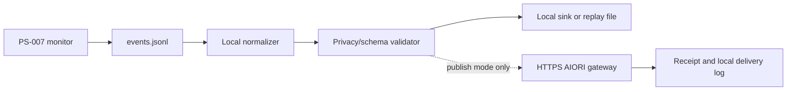

# AIORI Integration

**Project:** A3-PS007-TC042  
**Role:** Local AIORI-IMN edge measurement adapter  
**Status:** Local and publish-ready; external AIORI credentials and endpoint are not configured

This document defines the integration boundary between PS-007 and the future AIORI
infrastructure. It is intentionally local-first: the project can demonstrate,
inspect, validate, and replay AIORI-shaped telemetry without making an external
request or requiring an API key.

The integration must preserve the project’s primary privacy invariant:

> Hardware MAC addresses are never read, stored, or exported.

## 1. Current implementation boundary

The current PS-007 runtime already supplies the local data needed by an adapter:

| PS-007 component | Local integration surface |
| --- | --- |
| `monitor.py` | Detects rogue RAs and NDP abuse, performs attribution, and emits events |
| `telemetry.py` | Writes structured JSONL events and broadcasts them over WebSocket port `8765` |
| `state_snapshot.json` | Atomic live monitor snapshot for local consumers |
| `frontend/app.py` | Exposes `/api/state`, `/api/history`, `/api/privacy_audit`, and the dashboard |
| `pseudonym.py` | Creates epoch-keyed pseudonyms and expires address/session state |
| `attribution.py` | Maps VLAN/link anchors to session IDs without MAC state |
| `detectors.py` | Produces the security alert types that become AIORI incidents |

This file is an integration contract and deployment guide. It does **not** silently
modify the existing monitor or dashboard. A future connector can consume the local
event stream and add the upstream transport as a separate adapter.

### Existing event types

`TelemetryEmitter.emit()` writes a JSON object per line to `events.jsonl` and also
mirrors it to `/tmp/events.jsonl` when the configured path is not already that
file. Existing producers use these event types:

- `bind`: a DAD address was accepted and associated with a pseudonym.
- `rotation`: an address or ratchet state changed.
- `alert`: a detector produced a security alert.
- `quarantine`: an SDN port was isolated.
- `expiry`: expired state was purged.
- `unquarantine`: a quarantine release was requested.

The local event format is an internal PS-007 format. It must be normalized before
being sent to AIORI; do not forward arbitrary JSONL fields as an upstream payload.

## 2. Local-first operating modes

The adapter should have an explicit mode rather than inferring publication from
the presence of a URL.

| Mode | Endpoint | Credential | Network behavior |
| --- | --- | --- | --- |
| `local` | local JSONL sink or test receiver | none | No external network request |
| `staging` | organizer-provided staging URL | staging credential | HTTPS only |
| `publish` | organizer-provided AIORI URL | live credential | HTTPS only |

Until AIORI provides an endpoint and key, use `local`. There must be no default
live URL, fake API key, or fallback that sends telemetry outside the machine.

Recommended configuration names:

```text
AIORI_MODE=local
AIORI_ENDPOINT=
AIORI_API_KEY=
AIORI_ANCHOR_ID=AIORI-IN-TC042
AIORI_TENANT_ID=tc042
AIORI_CONNECT_TIMEOUT_SECONDS=3
AIORI_QUEUE_LIMIT=1000
AIORI_MAX_RETRIES=3
```

Rules:

1. `AIORI_MODE=local` must not require `AIORI_API_KEY`.
2. `staging` and `publish` must fail closed if either endpoint or key is absent.
3. Credentials must come from the environment, a secret manager, or a protected
   deployment secret; never from source, JSONL, snapshots, or command output.
4. The endpoint must use `https://` outside an explicitly local address.
5. The adapter must report queue and delivery failures locally rather than
   pretending that an event was accepted upstream.

## 3. Local data flow



The adapter is asynchronous so a slow or unavailable AIORI service cannot stop
packet capture, detection, or local SDN quarantine. The local queue should be
bounded. When it is full, the adapter must record an explicit drop counter and
error; it must not block the security path indefinitely.

## 4. AIORI payload contract

Use a versioned envelope. The exact AIORI endpoint and schema version must be
confirmed by the organizers before enabling `staging` or `publish`.

### 4.1 Security incident

Normalize PS-007 `alert` and related `quarantine` events into this shape:

```json
{
  "schema_version": "aiori-imn-v1",
  "event_type": "IPV6_SECURITY_INCIDENT",
  "event_id": "uuid-generated-per-event",
  "observed_at": "2026-11-19T04:30:00Z",
  "anchor": {
    "id": "AIORI-IN-TC042",
    "project": "A3-PS007-TC042",
    "subnet": "fd00:abcd::/64"
  },
  "incident": {
    "alert_type": "NDP_RATE_ABUSE_HYSTERESIS",
    "severity": "HIGH",
    "session_pseudonym": "EPOCH-SCOPED-PSEUDONYM",
    "session_anchor": "SES-PORT08",
    "source_ip": "fd00:abcd::cafe",
    "target_ip": "fd00:abcd::1",
    "evidence": {}
  },
  "mitigation": {
    "action": "OPENFLOW_PORT_QUARANTINE",
    "switch": "s1",
    "port": 8
  },
  "privacy": {
    "mac_addresses_transmitted": 0,
    "zero_mac_policy_enforced": true
  }
}
```

`source_ip` and `target_ip` are optional and should be included only if the
confirmed AIORI policy permits IPv6 addresses. A pseudonym is valid only within
its epoch and tenant scope; it is not a permanent device identifier.

### 4.2 IPv6 health heartbeat

Heartbeat metrics should be derived from the local snapshot and event counters:

```json
{
  "schema_version": "aiori-imn-v1",
  "event_type": "IPV6_SLAAC_METRICS",
  "event_id": "uuid-generated-per-event",
  "observed_at": "2026-11-19T04:30:00Z",
  "anchor": {
    "id": "AIORI-IN-TC042",
    "subnet": "fd00:abcd::/64"
  },
  "metrics": {
    "active_iot_devices": 5,
    "address_rotations": 0,
    "dad_bindings_accepted": 0,
    "dad_bindings_rejected": 0,
    "security_alerts": 0,
    "quarantined_ports": 0,
    "current_epoch_id": 1
  },
  "privacy": {
    "mac_addresses_transmitted": 0,
    "zero_mac_policy_enforced": true
  }
}
```

Unknown or unavailable values must be represented by an explicit `null` or
omitted field according to the final AIORI schema. Do not invent measurements
such as latency, packet loss, or device count.

### 4.3 Privacy attestation

The local privacy audit is exposed by the existing dashboard API:

```text
GET http://127.0.0.1:5000/api/privacy_audit
```

An adapter may export a derived attestation, but it must not claim stronger
guarantees than the local audit verifies:

```json
{
  "schema_version": "aiori-imn-v1",
  "event_type": "ZERO_MAC_AUDIT",
  "event_id": "uuid-generated-per-event",
  "observed_at": "2026-11-19T04:30:00Z",
  "anchor_id": "AIORI-IN-TC042",
  "status": "COMPLIANT",
  "results": {
    "zero_mac_leakage": true,
    "mac_addresses_transmitted": 0,
    "hardware_fingerprinting_disabled": true,
    "link_session_anchoring": true,
    "epoch_forward_secrecy": true
  }
}
```

## 5. Normalization and validation requirements

Before local persistence or publication, validate:

- `event_type` is one of the approved integration event types.
- `schema_version`, `event_id`, `observed_at`, and `anchor.id` are present.
- `severity` is normalized to an agreed finite set.
- `session_pseudonym` is treated as ephemeral and never combined with a
  permanent identifier.
- `mac_addresses_transmitted` is exactly `0`.
- No key, value, nested object, or free-form detail contains a MAC address.
- Payload size is bounded before enqueueing or sending.
- JSON encoding is UTF-8 and uses no executable or templated content.

Rejected payloads must be written to a local error log with the reason and event
ID. They must not be sent upstream.

## 6. Local demonstration and verification

Run the existing PS-007 test suite from `src/`:

```bash
cd ~/A3-PS007-TC042/src
python3 -m unittest discover -s tests -p 'test_*.py' -v
```

Run the monitor and dashboard using the project’s normal Mininet setup. In a
second terminal, verify the local surfaces:

```bash
curl -sS http://127.0.0.1:5000/api/state
curl -sS http://127.0.0.1:5000/api/privacy_audit
tail -f events.jsonl
```

### Live bridge beside `monitor.py`

The live bridge follows only lines appended after it starts. Run it in a second
terminal while the monitor is running:

```bash
# Terminal 1: existing PS-007 monitor
sudo python3 monitor.py

# Terminal 2: local AIORI bridge
PYTHONPATH=. python3 aiori_live.py
```

The bridge prints one `[AIORI] queued ...` line for each normalized event and
writes validated payloads to `aiori_outbox.jsonl`. It does not replay the
existing history in `events.jsonl`. To use another event file or sink:

```bash
PYTHONPATH=. python3 aiori_live.py \
  --events /path/to/events.jsonl \
  --sink /path/to/aiori_outbox.jsonl
```

Stop it with `Ctrl-C`; the bridge drains its bounded queue before exiting.
Rejected events are printed with their validation error. In `publish` mode,
delivery failures are reported with a delivery status rather than being
silently treated as successful.

For an offline demonstration, keep `AIORI_MODE=local` and show:

1. a detector event appearing in `events.jsonl`;
2. the corresponding normalized payload being accepted by the local validator;
3. the dashboard privacy audit reporting zero MAC addresses;
4. no request being made to an external host.

The local mode is complete when the same normalized payload can be saved and
replayed later without changing its schema or event ID.

## 7. Enabling publication after credentials arrive

Do not enable publication until the organizers provide all of:

- the canonical HTTPS ingestion URL;
- authentication scheme and credential lifetime;
- accepted schema version and required fields;
- maximum payload size and rate limits;
- response and retry semantics;
- retention and privacy policy for IPv6 addresses and pseudonyms.

After those details are confirmed:

```bash
export AIORI_MODE=publish
export AIORI_ENDPOINT='https://<organizer-provided-host>/<path>'
export AIORI_API_KEY='<provided-out-of-band>'
export AIORI_ANCHOR_ID='AIORI-IN-TC042'
```

Use a staging credential first. Verify that:

- HTTP success is recorded only for the documented success codes;
- timeouts and `429` responses use bounded exponential backoff;
- non-retryable `4xx` responses are surfaced and removed from the retry queue;
- TLS certificate verification remains enabled;
- shutdown drains or explicitly reports the bounded queue;
- local detection and quarantine continue when the upstream endpoint is down.

## 8. Privacy and security non-negotiables

- Never read `Ether.src` for integration purposes.
- Never add MAC addresses to telemetry, snapshots, logs, URLs, headers, or
  error messages.
- Never use a raw IPv6 address as an `event_id`, anchor ID, or permanent device ID.
- Never reuse an epoch-scoped pseudonym as a cross-epoch identity.
- Never ship `events.jsonl` wholesale; normalize an allowlisted subset.
- Never put an API key in this repository.
- Never silently fall back from a failed publish attempt to a success response.

The existing uppercase [`AIORI_INTEGRATION.md`](./AIORI_INTEGRATION.md) contains
the original architecture blueprint. This lowercase document is the operational
local-first contract: it is safe to use before credentials exist and provides
the checklist needed to connect a separately implemented adapter later.
